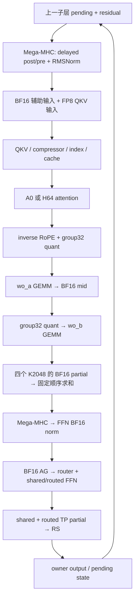

# DSV4.1 C256：下一轮优化方案

2026-10-30。实现基点：`8ba40a934d56e05f6e94975f70c0b4ad0542b89c`，分支 `yifehuan/dsv41_fusedmoe`；AITER：`c141da6bd10300dfc22da7777c23efc6c7b88712`。本页是源码调研后的实施计划，尚未实现下述新候选，本轮没有新增 GPU 实验。

建议依次做：**补齐成本和数值基线 → 迁移已有 owner 一次供料 → 融合投影的中间量化 → 按净成本决定是否开发大 M 的通信融合。** Mono 的任务依赖、缓冲区管理与通信合同可以复用；各模型的小批量计算调度需要重新设计后才能用于 C256。

## 1. 已有结果与下一轮对照

[完整 C256 A/B/A/B](dsv41_attention_result.md) 在保留原 owner/retained-prefill 优化后，得到 native attention **6268.705 → A0/H64 6642.675 output tok/s，额外 +5.966%**。两对为 +8.623% / +3.439%，B 重复漂移 −4.925%，尾延迟未一致改善，整网精度未验收。历史 1.191939× 来自旧时间点主线对照；两次倍率不能相乘称为当前实测总收益。

下一轮增量实验将 **A0 + 受限 H64 固定在两臂**，A 为这次已提交实现，B 只增加一个新候选。当前环境变量默认仍是 `native`，实验必须显式记录 `ATOM_DSV41_OWNER_FP8_ATTENTION=h64`；原 native 留作回归入口。最终如果要报告“相对当前主线共提升多少”，须另外安排同版本、同环境的主线对照。

固定目标：MI355X/gfx950，TP4/EP1/DP1，hidden5120，384 routed experts、top-6，专家有效 intermediate576、物理 padding640，MXFP8 激活 / MXFP4 routed 权重，FP8 KV、FP4 index、真实 DSpark5、FULL graph。C256 的主要 target 步是 **全局1536行、每 owner384行**；并发256不是 kernel 的 M256。221是补充 owner 容量，四份容量为884，须另核对实际有效行数和 padding。

已存在但未进入当前 owner decode 服务的[一次供料原型](dsv41_fp8_owner_supply_result.md)曾在完整 FFN/RS→下一层 mHC/QKV 窗口测得 1.03969×，约28.84µs/次。它是迁移起点，须针对当前依赖重新核对，不能直接记入新成绩。当前 `supports_prequantized_input=True` 只是入口可用；owner decode 仍从 BF16 `packed` 调用 FFN。retained-prefill 已有的预量化供料另行保留。

## 2. 当前计算链与可优化边界

实现入口：[完整 attention 链](../atom/models/deepseek_v41/owner_service/owner_cost_attention_chain.py)、[owner target](../atom/models/deepseek_v41/owner_service/owner_serving.py)、[Block 状态边界](../atom/models/deepseek_v41/model.py)。

短期有三处明确的读写可以检查：`wo_a` 的 BF16 mid 写回后立刻量化；FFN norm 的 BF16 AG 后各消费者重新量化；routed G1 的 BF16 中间结果随后再量化。需要分别保留其 BF16 舍入点，再考虑省掉全局内存往返。attention→inverse-RoPE、四 partial→mHC 也有潜力，但跨 CTA 归约和状态合同更复杂，放在后面。

## 3. Mono 源码能复用什么

下列 ATOM 链接均对应本页实现基点。复用优先级由目标形状和计算合同决定。

| 来源 | 已有机制 | 本任务可用部分 | 限制 |
|---|---|---|---|
| [公共执行模型](../atom/mono/plan/execution.py)、[同步](../atom/mono/device/sync.py)、[计划检查](../atom/mono/plan/check.py) | 256 CTA、512 threads、160KiB LDS；payload/tag 就绪发布，设备/系统作用域 | producer/consumer 检查、缓冲区生命周期、epoch、超时诊断、图内指针稳定性 | 一 CTA/CU、全部驻留；不能在另一个 stream 同时启动也要求整卡驻留的 persistent kernel |
| [V4.1 layer_post](../atom/models/deepseek_v41/mono/kernels/layer_post.py)、[合同](../atom/models/deepseek_v41/mono/contract.py)、[准入](../atom/models/deepseek_v41/mono/config.py) | K2a attention post 和 K2b MoE 合成一次 launch；norm 按行发布 XRDY；token-parallel gather 与 owner RS；LDS union | 最直接的 mHC→FFN 依赖参考；发布前完成 payload、跨 XCD 读取、重叠阶段 scratch 分离 | MAX_ROWS48 / MAX_MOE_ROWS96，draft最多8请求；M384/1536超范围。TP8列为可构建但有运行限制，不能扩大 guard 代替验证 |
| [GLM52 kernel](../atom/models/glm52/mono/kernels/kernel.py)、[配置](../atom/models/glm52/mono/config.py) | 完整 indexed layer DAG，tagged scratch，等待前预取权重，有序 TP sum | 按 FULL/REUSE 层建立任务图；用实际部署容量建立任务表，减少空任务枚举 | TP4/8，仅 batch1/2被测为更快而进入服务；query width1/4/5/6。其 top-k、路由和投影算术与 V4.1不同 |
| [MiniMax M3 post_attn](../atom/models/minimax_m3/mono/kernels/post_attn.py)、[moe_wide](../atom/models/minimax_m3/mono/kernels/stages/moe_wide.py)、[layout](../atom/models/minimax_m3/mono/layout.py) | index→attention→projection/AR→router→MoE；按被选中的 expert 归组；中间 MXFP8；随行数改变通信方式 | 按 expert 聚合工作、减少重复权重读取的组织方式；任务粒度与通信方式共同选择 | TP4、MAX_TOKENS16；WIDE_FROM5、AG_RS_FROM12属于该模型，不能复制为 C256 阈值 |
| [Kimi K3 layer](../atom/models/kimi_k3/mono/kernels/layer.py)、[配置](../atom/models/kimi_k3/mono/config.py) | 明确分配 CTA 职责，等待前加载权重；projection/AR/AttnRes→latent MoE | 预取与计算/服务 CTA 的放置方法，可用于分析等待和资源争用 | TP8、MAX_ROWS16；KDA、latent MoE、AttnRes不能替换 V4.1 的 sparse attention、普通 MoE 和 delayed mHC |
| [DeepSeek V4 layer](../atom/models/deepseek_v4/mono/kernels/layer.py)、[配置](../atom/models/deepseek_v4/mono/config.py) | 整层 attention/mHC/MoE、mailbox epoch、多量化模式 | 接口、生命周期、不同算术模式分开验证的组织方式 | V4-Pro TP8，已有小行数特化1–8及14；V4.1 pre-mix 来自上一子层，不能照搬 mHC 时序 |

工程选择：先用现有大矩阵 GEMM，加少量 epilogue 或边界融合。只有完整窗口显示主要损失来自阶段等待，并且融合后仍保住 GEMM 效率时，才考虑把多个阶段放进一个 persistent launch。不同层/不同 M 分派不同路径是允许的，拒绝路径须保持可测。

## 4. Mega 算子和 TileRT 的适用边界

### Mega-MHC 已启用，FFN 供料仍有扩展空间

[mhc_pre_delayed](../atom/model_ops/deepseek_v41/mhc_pre_delayed.py)已经在 gfx950 用 HIP Mega-MHC 合并 pending post、gate/Sinkhorn、carried pre-mix collapse 和 RMSNorm；attention 侧已请求 BF16 + MXFP8/E8M0 三份输出。FFN 侧仍返回 BF16。AITER [mega_mhc](https://github.com/ROCm/aiter/blob/c141da6bd10300dfc22da7777c23efc6c7b88712/aiter/ops/mega_mhc.py)含 hidden5120/M384 的流式选择，可作为 FFN 侧融合量化的实现基础。

需要注意两种依赖：router/辅助消费者仍需要 BF16，不能直接删掉它；Engram 要读取已 settle 的 residual，跨这个边界继续延迟或跨层融合会改变模型。Mega-MHC 的已有收益不重复计为候选收益。

### MegaMoE EP 与 TP 是两类后端

| 后端 | 源码与合同 | 当前决定 |
|---|---|---|
| MegaMoEV2 EP | [ATOM binding](../atom/model_ops/fused_moe/flydsl_mega_experts.py)：EP dispatch/G1/quant/G2/combine；MTPR≤255固定槽、≥256 compact；专有 weight shuffle | 与 TP4/EP1 的部署、权重切片不同。借鉴路由归组，不为套用它而改 EP 或模型配方 |
| MegaMoE TP | [公共 API](https://github.com/ROCm/aiter/blob/c141da6bd10300dfc22da7777c23efc6c7b88712/aiter/ops/flydsl/mega_moe_tp.py)、[engine](https://github.com/ROCm/aiter/blob/c141da6bd10300dfc22da7777c23efc6c7b88712/aiter/ops/flydsl/kernels/mega_moe_tp/mega_moe_tp.py)：`ag_rs`为owner行输入/输出，`ar`为复制输入/完整AR输出；API输入BF16，内部量化 | 接口方向适合 owner，但当前 FP8 大 M 调度缺失，不能直接启用 C256 |
| 现有 comm_fused MoE | [owner 分派](../atom/models/deepseek_v41/owner_service/owner_ffn_dispatch.py)、[FusedMoE](../atom/model_ops/moe.py)；bucket按实际shape、dtype、comm选择 | 接入已补齐，当前实际层仍 `comm_fused=False`。5120/640/E384/top6/TP4没有融合 winner，接口可调用不等于后端可用或更快 |

**MegaMoE TP 的 C256 阻碍已由源码确认，不能只检查 shape 或内存容量：**

1. `act_dtype="fp8"`令 `lb_min=0`；`dyn_max=min(max_local_tokens*tp,256)`。
2. `config(m)`在没有 LB、且 `m*tp > dyn_max` 时抛出 `act_dtype="fp8": ... tokens are beyond the dynamic schedule`。TP4 的 FP8 调度上限因此是 local64/global256；local384/global1536和local221均越界。即使构造期 `_fits/capacity` 通过也不能 launch。
3. 公共 API 的 big-M 路径仅接 FP4 激活，依赖 MoRI SDMA，并明确不支持 graph capture。修改激活格式或退出 FULL graph 会改变本轮比较条件。
4. 当前 `mega_moe_tp_tuned.csv` 共10条、big-M表5条，均无5120/640/E384/top6/TP4记录。独立 comm_fused runtime 查表在 AR/RS 两种模式也均无匹配 bucket。

若以后扩展 FP8 大 M，需要实现大行数任务/中间量化调度、重新计算 LDS/寄存器/route容量、编译并验证整组 collective，工作量属于新 kernel 开发。不能仅提高 DYN_MAX 或把1536行拆成六次小算子来声称解决了问题。

TP后端还要求：整卡驻留，所有rank调用次序/行数一致；capture前 collective prepare；超时置 sticky error 后输出无效，须同步处理并 reset；返回 scratch view 仅活到下一次调用。默认通信为FP8，首个保守对照应显式核对 BF16 transport、AR gather设置、shared贡献和归约顺序。即便通信BF16，内部GEMM/量化仍要数值验证。普通 residual+RMSNorm tail 不能替代 V4.1 delayed mHC。

### TileRT 公开原实现

本次读取官方 [tile-ai/TileRT](https://github.com/tile-ai/TileRT/tree/0ea19371f120977761bfa0cf6a2d08415d8fce0e)，固定版本 `0ea19371f120977761bfa0cf6a2d08415d8fce0e`，完整 checkout 放在仓外 `validation/commit_plan_20261030/references/TileRT`。

| 可见源码 | 对下一步的启发 | 不能由此推断的事 |
|---|---|---|
| [pure_mla_m567](https://github.com/tile-ai/TileRT/blob/0ea19371f120977761bfa0cf6a2d08415d8fce0e/tilert/models/glm_5_2_rocm/ops/pure_mla_m567.py) | attention split/merge→projection→AR 的接口、scratch布局和阶段时间戳 | Python wrapper没有公开全部 device scheduler 实现 |
| [pure_mla_moe_layer](https://github.com/tile-ai/TileRT/blob/0ea19371f120977761bfa0cf6a2d08415d8fce0e/tilert/models/glm_5_2_rocm/ops/pure_mla_moe_layer.py) | attention与MoE共用layer工作区、handoff、`reuse_selection`、分阶段tag | 不能把 GLM 的 selection 复用或层结构直接替换 V4.1 FULL/REUSE cache合同 |
| [fused_moe_allreduce](https://github.com/tile-ai/TileRT/blob/0ea19371f120977761bfa0cf6a2d08415d8fce0e/tilert/models/glm_5_2_rocm/ops/fused_moe_allreduce.py) | 明确samples/权重/scratch/tag参数 | FUSED_SAMPLES仅1/2/4，配置为GLM TP8、hidden6144/E256/top8；不能外推到C256 |
| [end2end](https://github.com/tile-ai/TileRT/blob/0ea19371f120977761bfa0cf6a2d08415d8fce0e/tilert/models/glm_5_2_rocm/end2end.py) | 临时区校验、单owner lease、prepare/reset/release，长期驻留状态要有独占所有权 | `torch.ops.tilert.glm52_show_hands*`进入二进制后端；本次没有查看其私有C++/device内部实现 |

TileRT定位为低延迟小batch。公开wheel的ROCm ABI要求 torch2.12.0+rocm7.14.0，与本机当前实验栈不同；本轮只研究已公开源码，没有安装或运行其wheel。ATOM GLM引用的 InferenceX版本 `8ac98344b038a3f2da20a565fe9b974772a67ef9`主要提供部署配方，也不能当成TileRT device实现的替代来源。

## 5. 实施顺序与交付条件

下列时间是兼容依赖已具备时的工程估计，包含接口/数值/局部验证，不是GPU运行时长，也不保证收益。发现合同不一致时先停止对应候选。

| 顺序 | 具体交付 | 预计投入 | 晋级条件 / 停止条件 |
|---|---|---|---|
| P0 | 当前版本完整窗口基线、默认投影native-self、低扰动成本表；正式区间计数方案 | 0.5–1天 | 数值差异来源、计时扰动可区分；未接受的阶段计时不用于预算 |
| P1 | owner decode一次供料移植；再单独试FFN Mega-MHC直接输出量化结果 | 1–2天 | 真实G1供料/路由一致，完整FFN/RS→下一层窗口净收益；不为旧1.03969×单独反复整网 |
| P2 | `wo_a` BF16舍入后的group32量化epilogue，直接产出`wo_b`所需layout | 2–4天 | 保住原GEMM吞吐，values/scales合同通过，完整attention窗口净收益 |
| P3 | 仅decode G1 epilogue融合中间量化；或选择准备阶段一个更大的已量得重复读写 | 2–4天 | 先证明阶段成本值得投入；prefill已有融合不重复开发；量化前舍入和激活规则一致 |
| P4 | C256 FP8通信融合可行性规格；通过后才开发一条完整FFN/RS候选 | 0.5–1天规格审计；新调度约5–10天或更长 | 有明确可回收等待且预计大于新增成本；不得以缩小GEMM或改变精度配方换取表面重叠 |

### P0：先把下次实验做准、做短

复用当前 layer8 FULL→layer9 REUSE真实权重fixture，不重建旧launcher。先保留M384/8K的完整窗口；4K用于快速排除明显退化，221补充边界正确性。旧fast进程包含加载、数值、ABBA约21–26秒，说明局部验证可以很快，但新kernel编译时间需另记。

阶段成本按 prepare/cache/index、attention、inverse-RoPE/quant、wo_a/quant/wo_b/reduce、mHC、FFN AG/router/shared/G1/G2/combine/RS 拆开观察。每次只插一个区域，先比较带/不带观察的完整窗口；扰动超过1%的记录不作为精确预算。现有 `integrated_r1` 的L8 attention约61.5–63.1µs、projection+mHC约87.5–88.5µs通过当时的扰动判据；prepare约214–218µs未通过，L9多数分项也未通过。它们还使用了受控投影，不能据此认定默认生产版本的准备阶段占比。

数值同时保留两套条件：默认生产投影做A/A自比较及候选对照；确定性投影只用于隔离候选误差。已有默认index BF16 split-K atomic与compressor不确定性会放大到top-k/cache选择；不能拿受控投影通过来宣布生产精度通过，也不扩大容差掩盖新的偏差。

整网计数先实现为未来短服务的诊断选项：在正式首/末请求区间取同一统计口径的差值，记录accepted/drafted tokens、target实际/填充行数、graph bucket及replay次数、FULL/REUSE层型、prefill/target/draft调用量、fallback和实际FFN backend。host绑定计数不能代替replay计数。GPU时钟/功率/温度按同一工作负载阶段采样；不改机器频率来追分。用这些信息排查现有B1/B2漂移，计数开发本身不触发新的完整四臂。

### P1：先复用一次供料，再消除它内部的一次量化

1. 在owner `prepare_ffn` 后保留BF16本地norm；owner gate使用当前full-M基线实际选中的相同算术调度。旧1765只能作为线索，先核对当前kernelName/参数；普通local-M lookup可能选不同split-K，不能直接代换。hash层、image路由、未知shape保留fallback。
2. 参考 [prefill_ffn](../atom/models/deepseek_v41/prefill_ffn.py) 和旧供料原型，先按owner量化一次，AG values/scales/logits，再供给原native shared/routed，保持G1/G2 callable、真实M/K/N与参数。FP8/E8M0传输是字节搬运，明确rank-major顺序、有效行数和padding。TP4当前不支持现成preselected_routes合同，先传logits，不照搬EP4的route packet。
3. 上述端到端正确后，再在FFN侧显式请求Mega-MHC `(BF16, FP8, E8M0)`，替掉owner独立quant；保留BF16供router读取。比较“当前、仅一次供料、一次供料+MHC量化”以确定组合净收益，检查输出scale layout与原`quantize_fp8`完全一致。
4. 预量化原生路径与BF16 comm_fused路径显式择一，记录实际入口。不能因绑定后端而误取消预量化资格，也不能把FP8/scales传入只吃BF16的融合后端。

完整边界必须从 `prepare_ffn` 的输入开始，包括mHC、所有AG/router/shared/routed、combine/RS、`finish_ffn`，到layer9的mHC/norm/QKV消费者结束。只量AG或quant会漏掉路由选表、三个小包collective、shared等待和下一层状态成本。退化或收益低于重复噪声时保留原路径。

### P2：投影 epilogue 先做一处

第一候选只改 `wo_a → quantize_fp8(mid.view(M,4,2048))`。在wo_a输出tile内完成原先的**FP32 accumulator→BF16舍入→group32量化**，产出wo_b所需FP8和E8M0排列；不把未舍入的FP32直接量化。先确认每个scale组在同一tile内具备全部元素，处理N尾部、scale存储顺序、G维转M维布局；若scale组跨CTA而必须重新全局物化，就重算收益预算。

M384时mid为384×4×2048个BF16，单份约6MiB。省掉其完整写回和再读取，逻辑上最多减少约12MiB/层/rank的往返；这只是逻辑字节，不是实测HBM带宽或节省时间。若调试observer需要mid，保留独立诊断输出模式，正式计时使用不物化mid的同算法路径。

wo_b继续四个原始K2048，分别生成BF16 partial；[sum_original_tp](../atom/models/deepseek_v41/owner_service/owner_serving_kernels.py)按owner、owner+1…的环形顺序转FP32累加，再转BF16。不得合并成单个K8192 GEMM，或提前把FP32 partial直接喂mHC。后续如做reduce+mHC，应逐项保留这套舍入/求和及delayed状态，再单独立项。

数值先对固定encoded/scales检验mid语义、输出FP8字节、scale字节和wo_b输入，再跑完整准备/cache/attention/投影/mHC窗口，覆盖layer8/9、M384/221和graph更新。只对projection单算子更快、完整窗口不快的候选不接服务。

### P3：以成本决定第二处融合

decode routed G1当前可出现 `G1 BF16 → 独立quant → G2`。若P0证明这段仍有可回收成本，优先在原G1输出tile融合量化，保持clamp/SwiGLU、padding576→640、每expert/top-k槽的scale与路由权重应用阶段；G2保留原大矩阵调度。先核对当前依赖是否已对该shape融合，prefill已有融合则排除。

如果默认准备阶段更贵，则选一个已经证明多余的cache/query layout转换或重复量化来删。保留compressor/index流join，FULL产生selection、REUSE消费selection，tentative replay/commit/rollback及CSR有效区合同。H64当前仅改变调用粒度，不据此声称做了跨CTA KV复用；新的KV复用内核只有在H64后attention仍占显著成本时才排入计划。

### P4：通信融合先做可行性规格

目标依赖是 `本地norm就绪 → 路由/量化/AG → 完整G1/G2 → owner RS → 下一层mHC`。从V4.1 layer_post与TileRT借鉴ready/tag、scratch所有权和consumer布局；从MegaTP借鉴collective和错误处理。C256实现必须采用能维持大M GEMM吞吐的tile调度。

优先比较两个明确的输出合同：

- **AR接入较短**：复制输入、完整TP all-reduce输出已含shared；owner只取自己行，不能再加shared或RS。仍需计入原BF16 AG和shared生产等待；可能因此没有净收益。
- **AG/RS边界更匹配owner**：输入local384、输出local384；需要为shared和routed保留一致的供料及归约。当前`finish_output`只接完整AR或全行TP partial，必须新增明确的owner-complete输出合同，不能把local输出硬塞进已有`complete=True`。

只在已支持的global≤256先做MegaTP小形状合同验证时，结果仅能作为实现调试；它还可能与已有小M Mono覆盖重叠，不能计为C256收益。C256候选先补FP8大M调度及真实权重layout、BF16通信/原数值规则，再完成图capture、多rank epoch、超时无效输出和复用检查。persistent模式下shared/侧流工作要先join或放进同一有驻留保证的调度，不能让两套整卡persistent kernel互相等待。

现有comm_fused后端则先离线确认目标完整shape确有可调用调度，再用仓外独立配置试一个完整窗口；无winner时fallback。不得改原AITER CSV、伪造记录强开后端，或大范围扫描旧失败的分列路线。

## 6. 每个候选的验证与停止规则

| 层级 | 必需内容 | 能回答的问题 |
|---|---|---|
| 加载前准入 | shape/stride/dtype、576→640 padding、scale布局、缓冲区容量、输出ownership、fallback；与变更相关的CPU合同检查 | 是否值得加载真实权重进入GPU实验 |
| 固定输入数值 | values/scales、router logits/top-6、四partial及最终状态；native-self、candidate-self、eager/graph；cache backing/CSR/输入不变性、tentative replay幂等 | 是否保住局部计算与状态合同 |
| 完整局部窗口 | 同权重/输入/初始cache，三组变化输入、每组ABBA，按每臂四rank最大时间统计；先64次replay，太短或噪声大才增加 | 新候选是否在包含准备和消费者成本后仍更快 |
| 短服务筛选 | 获胜候选组合一次；保持C256/8K1K/DSpark5，先只减少正式请求数，例如512条；各臂相同准备，正式区间记录实际行数/AL/命中 | 是否进入真实路径、服务趋势是否与局部一致；不能替代dashboard成绩 |
| 完整服务确认 | 获胜且稳定的组合只安排一轮同配方A/B/A/B：512预热、2560正式/臂，源文件/CSV一致 | 是否有完整C256增量收益及尾延迟代价 |
| 精度验收 | 先小量真实prompt的logits/生成/MTP检查；形成完整、显著且稳定的大优化后，再一次完整GSM8K，或按用户另行要求 | 局部数值与性能不能替代任务精度验收 |

局部筛选门槛预先固定：所有rank配对均正向，净耗时下降大于 `max(1%, 2×本轮最大重复漂移)`，且两种输入/层型不出现未解释的退化；这是工程筛选，不声称统计显著性。小而便宜的融合可作为组合候选保留，无须为了达到人为百分比扩大改动。完整服务只有两次重复/模式时，仍报告两对结果和漂移；增益与噪声不可区分、错误/冷编译进入正式段或P99明显恶化时不升级默认。

每次只编译/验证新的候选，一次权重加载内完成必要数值和ABBA；已有冻结证据不重跑。脚本、原始日志、源哈希、dispatch记录、退出码放仓外；仓内只保留简明结论及可审阅证据。4K只用于已有相近形状快速筛选，最终仍回8K；单层收益不乘层数报告整网吞吐。

继续停止三条已有净退化路线：BF16十列+RCCL、FP8设备Window、compact BF16 chunk-ready。新方案若依然靠切碎G2列、额外partial物化和逐块flag，只是参数不同，则没有新的立项依据。只有生产者输出格式或真正的依赖边界改变，且预算覆盖额外成本时才重开。

## 7. 提交与检查状态

`8ba40a934`包含这次已测attention候选、owner FFN分派和完整A/B/A/B摘要。默认attention保持native，通信后端未启用。6份改动源码Black/Ruff/语法、8项FFN合同、accuracy catalog schema通过；GPU证据与源码哈希一致。

完整CPU脚本因分支已有 `test_row_sharded_mhc.py` 在无AITER环境的导入错误而停在收集阶段；该测试不存在于主线基点124c3b0d1，不归因为主线失败。全库Black有10份未修改文件不合格式，Ruff有426条诊断、改动源码无诊断。它们未记为全CI通过；后续push/PR前须按适用CI范围处理并复验。本次只做本地提交，无关联PR/远端checks，未push。

证据入口：[attention结果](dsv41_attention_result.md)、[机器可读A/B/A/B](dsv41_results_20261030/attention_abab/summary.json)、[旧供料结果](dsv41_fp8_owner_supply_result.md)。本机检查清单在 `../validation/commit_plan_20261030/CHECKLIST.json`，新增源码调研记录在同目录 `references/SOURCE_AUDIT.json`。库外资料不随Git分发，原AITER CSV未修改。
